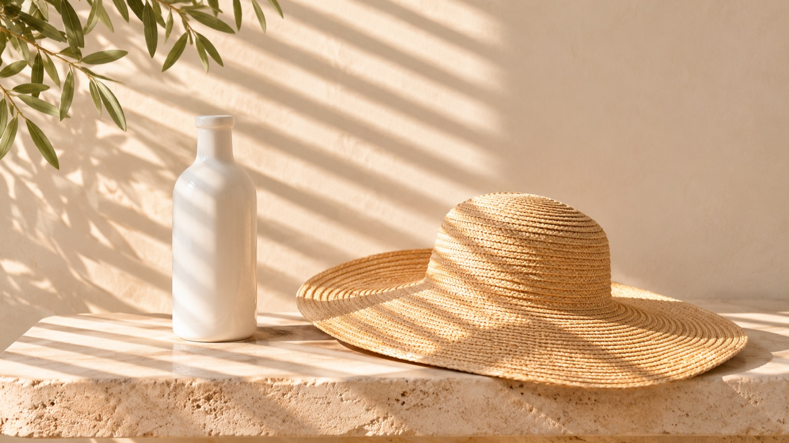

거울 앞에 선 스물여섯 살이 눈가를 손가락으로 살짝 당겨 봅니다. 주름은 아직 없어요. 그런데 휴대폰에는 '리프팅'을 검색한 기록이 남아 있습니다. 이유를 물으면 대개 이렇게 답합니다. "생기고 나서 하면 늦을 것 같아서요."

주름이 생기기 전에 미리 관리한다는 이 생각에는 이름도 붙었습니다. 예방(prevention)과 회춘(rejuvenation)을 합친 '프리주브네이션(prejuvenation)'이에요. 그럴듯하게 들리는 말이지만, 정말 미리 하면 덜 늙는 걸까요?

## 주름보다 검색 기록이 먼저 생긴다

요즘 뷰티 기사와 SNS에서는 '얼리 안티에이징'이라는 말이 심심찮게 보입니다. 처짐을 되돌리려는 사람이 아니라, 처지기 전에 막아 보려는 사람들이 리프팅과 주사 시술 이야기에 끼어들기 시작한 거예요.

숫자로 확인할 수 있는 흐름도 있습니다. 미국의 미용의료 업계 데이터를 보면, 미용 시술을 받는 사람 가운데 1997년 이후 태어난 Z세대의 비중이 2017년 약 4%에서 2024년 약 10%로 늘었습니다. 일곱 해 사이에 두 배가 넘게 커진 거죠. 학계의 관심도 따라왔어요. 미국 국립의학도서관 논문 데이터베이스에서 '프리주브네이션'이라는 단어로 잡히는 논문은 2022년 2건에서 2025년 6건으로 늘었고, 2026년에는 11월까지 7건이 나왔습니다. 그중에는 젊은 층의 예방 시술이 어떤 윤리적 질문을 던지는지 따진 논문도 있습니다. 관심이 커졌다는 건 분명하다는 얘기예요.

*가장 오래 검증된 예방은 의외로 평범하다 · AI 생성 이미지*

## 가장 오래 검증된 예방은 의외로 평범하다

그렇다면 '미리 하면 덜 늙는다'는 생각에 과학은 뭐라고 답할까요. 흥미롭게도, 피부 노화를 늦추는 예방법 가운데 가장 탄탄한 근거를 가진 건 장비가 아니라 자외선 차단제입니다.

호주에서 55세 미만 성인 903명을 4년 반 동안 추적한 연구가 있어요. 참가자를 무작위로 나눠 한쪽은 자외선 차단제를 매일 바르고, 다른 쪽은 필요할 때만 바르게 했습니다. 손등 피부의 미세한 결을 본떠 비교했더니, 매일 바른 쪽은 피부 노화가 진행된 정도가 24% 적었습니다. 무작위로 나눠 몇 년을 지켜본, 근거의 등급으로 치면 꽤 높은 단계의 연구예요.

햇빛이 얼마나 큰 변수인지 보여 주는 연구도 있습니다. 30~78세 여성 298명을 햇볕을 즐기는 사람과 피하는 사람으로 나눠 얼굴을 살펴본 관찰 연구에서는, 눈에 보이는 얼굴 노화 징후의 약 80%가 자외선 노출과 관련된 것으로 추정됐어요. 다만 같은 연구에서 반전이 하나 나옵니다. 리프팅이 겨냥하는 바로 그 '처짐'은 햇빛 습관보다 나이와 더 관련이 있었다는 거예요.

> 예방에 대한 가장 오래된 증거는 화려한 장비가 아니라 매일 바르는 자외선 차단제 쪽에 있습니다.

*예방이라는 말 앞에서 근거를 들여다볼 때 · AI 생성 이미지*

## 장비로 하는 예방, 증거는 어디까지 왔나

그럼 장비나 주사로 하는 '예방'은요? 자주 인용되는 사례가 하나 있습니다. 13년 동안 한 사람은 이마와 미간에 보툴리눔 톡신을 꾸준히 맞고, 다른 한 사람은 맞지 않은 일란성 쌍둥이를 비교한 2006년 보고예요. 맞은 쪽의 이마 주름이 덜 보였다고 합니다. 이야기로는 강렬하지만, 이건 쌍둥이 한 쌍을 비교한 사례 보고입니다. 생활 습관의 작은 차이까지 통제할 수 없으니, 이것만으로 '미리 맞으면 주름이 덜 생긴다'고 말할 수는 없어요.

고주파 같은 에너지 장비 리프팅은 사정이 더 복잡합니다. 이 장비들은 열 에너지로 피부 아래 조직을 자극하는 원리로, 이미 처짐이 시작된 사람을 대상으로 연구돼 왔어요. 처짐이 없는 젊은 피부에 미리 써서 먼 훗날의 노화를 늦췄는지 오래 따라가 본 연구는 찾기 어렵습니다. 피부과 전문 매체와 학술 논평들도 젊은 층의 예방 목적 시술이 오랜 기간에 걸쳐 노화를 늦춘다는 근거는 아직 부족하다고 지적합니다. 물론 조심스러운 조기 관리는 합리적일 수 있다는 의견도 있어서, 학계의 결론은 아직 열려 있다고 보는 편이 정확해요. 다만 예방이라는 말이 붙었다고 해서 예방 효과가 확인된 건 아니라는 뜻이죠.

## 그래서 스물여섯 살은 무엇을 기억하면 될까

정리하면 이렇습니다. 피부를 일찍 아끼고 싶다는 마음 자체는 이상하지 않아요. 다만 그 마음을 어디에 쓸지는 근거의 순서를 따라가 보는 게 좋습니다.

먼저, 근거가 가장 단단한 건 매일의 자외선 차단입니다. 장비 시술보다 덜 극적이지만, 무작위 대조시험으로 노화를 늦춘다는 결과가 나온 몇 안 되는 방법이에요. 다음으로, '예방' 시술을 고민한다면 내 피부에 지금 해결할 문제가 있는지, 아니면 아직 오지 않은 문제를 미리 사려는 건지 스스로 물어볼 만합니다. 그리고 시술은 결국 의료 행위라서, 효과만큼이나 부작용 가능성과 내 피부 상태에 맞는지를 피부과 전문의와 충분히 상의하는 과정이 필요합니다.

주름보다 검색 기록이 먼저 생기는 시대. 미래의 얼굴을 위해 오늘 할 수 있는 가장 확실한 일은, 생각보다 평범한 곳에 있을지도 모릅니다.
