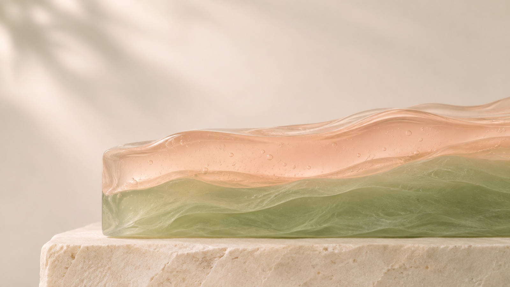

몇 달 만에 만난 친구가 확실히 날씬해졌습니다. 그런데 이상하게도 "살 빠졌네"보다 "좀 피곤해 보인다"는 말이 먼저 나옵니다. 볼이 조금 홀쭉해졌고, 웃을 때 팔자 주름이 전보다 깊어 보이거든요. 요즘 이 장면에는 이름이 붙어 있습니다. 비만치료제 이름을 딴 '오젬픽 페이스', 우리말로는 '위고비 페이스'예요.

살이 빠졌는데 왜 얼굴은 나이 들어 보일까요. 약이 얼굴을 늙게 만드는 걸까요, 아니면 다른 이유가 있는 걸까요.

## 주사 한 대가 바꾼 거울 앞 풍경

GLP-1 계열 약은 원래 당뇨병 치료에 쓰이던 약입니다. 식욕을 줄이고 포만감을 오래 가게 해서 체중을 크게 줄여 준다는 사실이 알려지면서 비만 치료제로 자리를 넓혔어요.

국내에서도 속도가 빨랐습니다. 건강보험심사평가원의 의약품 안전사용 점검(DUR) 자료가 국정감사에서 공개됐는데, 2025년 8월 나온 마운자로는 1년 동안 약 264만 건, 2024년 10월 나온 위고비는 2026년 5월까지 약 123만 건이 점검됐어요. 두 약 모두 건강보험이 적용되지 않아 정확한 처방량을 셀 수 없기 때문에 이 숫자는 '점검 건수'이고, 두 수치는 기준 시점도 다릅니다. 그래도 방향은 분명합니다. 체중 감량 주사가 몇몇 사람의 이야기에서 일상의 선택지로 옮겨 왔다는 것이죠.

관심의 방향도 따라 움직였습니다. 2026년 1월 미용피부과 학술지에 실린 구글 검색 분석을 보면, 2021년 말부터 2024년 말까지 'Ozempic face'의 상대 검색량이 4,600% 늘었어요. 출발점이 워낙 낮았던 탓도 있지만, 사람들이 약의 효과만큼이나 '얼굴에 남는 것'을 궁금해하기 시작했다는 신호로 읽힙니다.

*피부 아래 지방은 한 덩어리가 아니라 여러 층으로 나뉘어 있다 · AI 생성 이미지*

## 얼굴은 한 덩어리가 아니라 여러 층이다

그렇다면 얼굴에서는 실제로 무슨 일이 일어날까요. 2026년 10월 미국 미용성형 학술지에 실린 종합 리뷰가 지금까지의 자료를 한데 모았습니다. 958건의 기록을 훑어 46개 보고를 추렸어요.

가장 눈에 띄는 숫자는 영상 자료에서 나옵니다. GLP-1 계열 약으로 체중을 줄인 20명의 얼굴을 반복해서 촬영해 보니, 볼 부위(중안면) 부피가 중앙값으로 9% 줄었습니다. 흥미로운 건 줄어든 위치예요. 피부 바로 아래 얕은 지방층은 11%, 그보다 깊은 지방층은 7% 줄었습니다.

얼굴 지방은 하나의 큰 쿠션이 아니라 칸칸이 나뉜 여러 개의 작은 주머니에 가깝습니다. 그중 겉쪽 주머니가 더 많이 줄면, 피부를 안에서 받쳐 주던 볼륨이 얇아지고 주름과 그늘이 도드라져 보일 수 있어요. 같은 리뷰는 체중이 10kg 빠질 때마다 중안면 부피가 약 7%씩 줄어드는 것으로 추정했습니다.

빠지는 게 지방만도 아닙니다. 세마글루타이드 비만 임상(STEP 1)의 체성분 분석에서는 68주 동안 약을 쓴 쪽의 제지방량(지방을 뺀 근육·뼈·수분 등의 무게)이 평균 5.8kg, 위약을 쓴 쪽은 1.8kg 줄었어요. 몸 전체의 이야기지만, 감량이 지방만 골라 덜어 내는 일은 아니라는 점을 보여 줍니다.

## 범인은 약일까, 속도일까

여기서 반전이 하나 있습니다. 앞의 리뷰는 '오젬픽 페이스'라는 이름부터 짚었어요. 이 말이 마치 약 고유의 부작용처럼 들리지만, 비슷한 변화는 비만 수술처럼 다른 방법으로 크게 살을 뺀 뒤에도 나타난다는 겁니다.

> 지금까지의 근거는 약이 얼굴을 직접 늙게 한다기보다, 원래의 얼굴 구조와 노화 위에 '체중 감량에 따른 꺼짐'이 겹친 것으로 보는 쪽에 무게를 둡니다.

그렇다고 모든 게 밝혀진 건 아닙니다. 같은 리뷰는 감량 속도가 그 자체로 얼마나 영향을 주는지, 폐경이나 호르몬 치료가 어떤 역할을 하는지는 아직 불확실하다고 적었어요. 이 변화를 되돌리려는 미용 치료의 근거도 제한적이고, 대부분 비교 대상 없이 진행된 연구라고 덧붙였습니다.

2026년 미용성형 학술지에 실린 또 다른 체계적 문헌고찰(40개 연구)은 피부 변화가 더 두드러질 수 있는 조건을 꼽았습니다. 나이가 많을수록, 비만 기간이 길었을수록, 살이 빨리 빠질수록, 그리고 물과 단백질을 충분히 챙기지 못할수록 그렇다는 거예요. 다만 이 연구진 역시 원인과 관리법을 제대로 밝히려면 앞으로 사람을 따라가며 지켜보는 연구가 더 필요하다고 결론 내렸습니다.

*속도와 영양, 감량을 둘러싼 오래된 기본기 · AI 생성 이미지*

## 그래서 거울 앞에서 기억할 것

'위고비 페이스'는 결국 약 하나의 문제라기보다, 짧은 시간에 큰 감량이 일어날 때 얼굴이 보내는 신호에 가깝습니다. 그렇다면 독자가 챙길 수 있는 건 의외로 기본적인 것들이에요.

첫째, 속도입니다. 감량 속도가 얼굴에 얼마나 영향을 주는지는 아직 확정되지 않았지만, 빠른 감량은 피부 변화의 위험 요인으로 거듭 언급됩니다. 목표 체중만큼이나 '얼마나 빨리'를 처방한 의사와 함께 이야기해 볼 만합니다.

둘째, 근육과 영양입니다. 빠지는 무게에 제지방이 섞여 있다는 사실은 단백질 섭취와 근력 운동을 그냥 흘려 넘기면 안 되는 이유가 됩니다. 수분 섭취도 연구진이 함께 꼽은 항목이에요.

셋째, 기대치입니다. 얼굴 변화를 바로잡겠다는 시술 이야기가 많아졌지만, 학계가 스스로 밝히듯 그 근거는 아직 탄탄하지 않습니다. 얼굴이 달라 보여 걱정된다면 서두르기보다 피부과 전문의와 충분히 상담하고, 감량이 안정된 뒤 차분히 판단하는 편이 낫습니다.

살이 빠졌다는 사실과 얼굴이 달라 보인다는 사실은 둘 다 진짜입니다. 다만 그 사이에 놓인 과학은 아직 쓰이는 중이에요.
