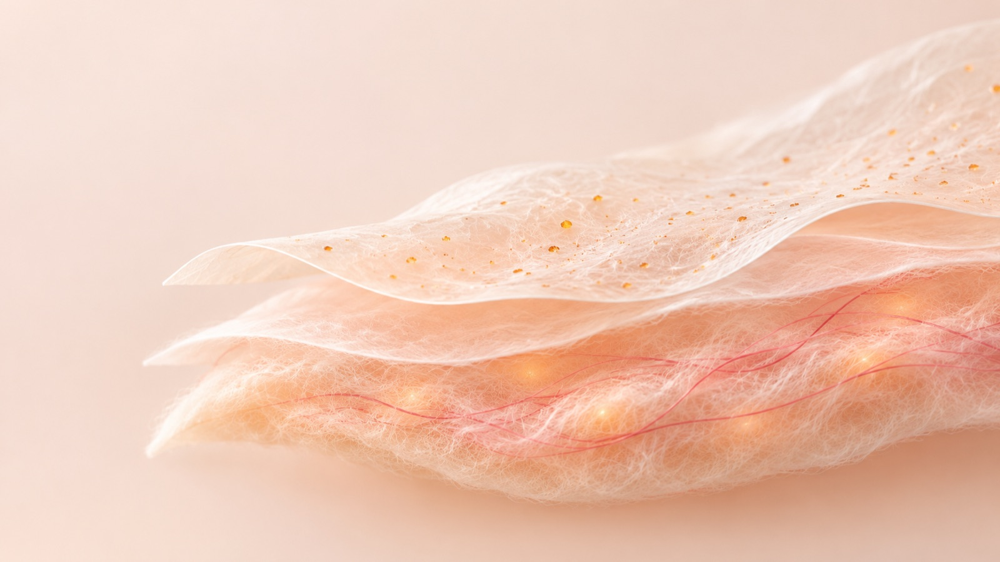
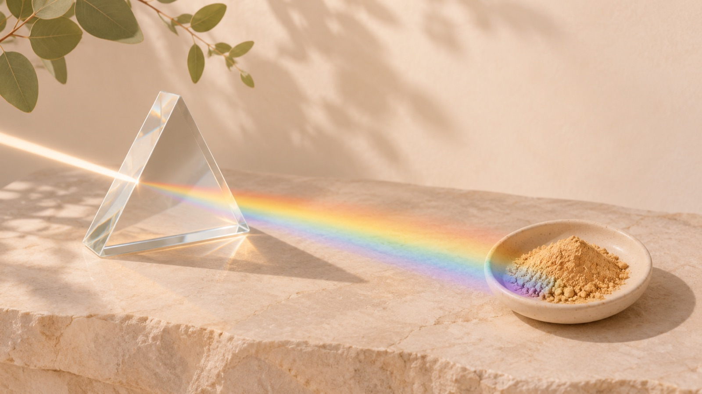

"레이저를 몇 번 받으면 기미가 지워지나요?" 기미 상담에서 가장 먼저 나오는 질문이에요. 솔직한 답은 "옅어질 수는 있지만, 지운다는 생각으로 접근하면 실망하기 쉽다"입니다. 올해는 약국에서 처방 없이 사는 하이드로퀴논 기미 크림이 여러 품목 새로 허가되고 출시됐어요. 선택지는 많아졌는데, 기미가 어떤 병인지 모르면 무엇을 고르든 같은 자리를 맴돌게 됩니다.

## 기미는 '색소 덩어리'가 아니라 피부 전체의 반응이에요

*표피의 색소 아래에는 혈관과 섬유, 세포 신호가 얽힌 진피가 있다 · AI 생성 이미지*

피부는 바깥쪽 표피와 그 아래 진피로 나뉘어요. 멜라닌을 만드는 멜라닌세포는 표피 맨 아래층에 있고, 그 바로 밑에 표피와 진피를 붙여 주는 얇은 막(기저막)이 깔려 있습니다. 예전에는 기미를 "멜라닌세포가 과하게 일하는 표피의 문제"로만 봤어요. 그런데 최근 연구들은 그보다 훨씬 복잡한 그림을 보여 줍니다.

2025년 국제피부과학회지에 실린 종설은 기미 피부에서 함께 나타나는 변화를 이렇게 정리했어요. 오랜 자외선으로 진피 섬유가 뭉개지는 일광 탄력섬유증, 늘어난 혈관, 염증 신호를 내는 비만세포, 신호를 계속 뿜어내는 노화 섬유아세포, 그리고 군데군데 손상된 기저막이에요. 여기에 여성호르몬과 가시광선이 불을 붙입니다.

쉽게 말해 기미는 표피에 묻은 얼룩이 아니라, 그 아래 진피가 "색을 더 만들라"는 신호를 계속 올려 보내는 상태예요. 표면의 색만 걷어 내도 신호가 그대로면 색은 다시 차오릅니다. 기미가 유독 재발이 잦은 이유가 여기에 있어요.

그래서 진단부터 정확해야 합니다. 볼에 생긴 갈색 반점이 모두 기미는 아니에요. 경계가 뚜렷한 검버섯(일광흑자)이나 주근깨는 레이저에 잘 반응하는 편이지만, 기미는 다르게 움직입니다. 둘이 섞여 있는 얼굴도 흔해서, 피부과에서는 무엇이 어느 자리에 있는지부터 나눠 봐요.

## 레이저가 기미를 옅게도, 짙게도 만드는 이유

*자외선 너머의 가시광선도 기미를 건드리는 빛으로 꼽힌다 · AI 생성 이미지*

국내에서 기미에 가장 많이 쓰는 것은 낮은 에너지로 여러 번 쏘는 Nd:YAG 레이저 토닝이에요. 멜라닌을 조금씩 부수되, 염증은 최소로 남기려는 방식입니다. 실제로 단기 효과는 있어요. 다만 2023년 피부외과학회지(Dermatologic Surgery)에 실린 메타분석을 보면, 토닝만 했을 때의 효과는 시간이 지나며 줄어 24주쯤 지나면 치료 전과 거의 차이가 없었어요. 바르는 약이나 먹는 약을 함께 쓴 쪽이 더 오래 버텼고요.

더 조심할 것은 부작용입니다. 같은 분석에서 얼룩덜룩하게 하얗게 빠지는 저색소, 염증 뒤에 오히려 짙어지는 과색소침착, 재발이 보고됐어요. 저색소는 시술 횟수가 많을수록 잘 생겼습니다. 앞서 말했듯 기미 피부의 진피는 이미 예민한 상태라, 열과 염증이 쌓이면 그게 새 자극이 되기 때문이에요.

> 기미 치료의 목표는 '지우기'보다 '가라앉혀 두기'에 가깝습니다.

레이저는 쓸모없는 도구가 아니에요. 다만 기미에서는 주인공이 아니라 조연에 가깝고, 횟수와 간격을 아끼며 다른 치료와 함께 쓸 때 제 몫을 합니다.

## 근거가 가장 단단한 세 가지: 빛 차단, 바르는 약, 트라넥삼산

**첫째, 빛 차단은 모든 치료의 바닥이에요.** 여기서 하나 덧붙일 것이 가시광선입니다. 자외선만 막는 투명한 차단제로는 부족할 수 있어요. 2014년 이중맹검 무작위 임상시험에서는 기미 환자 모두에게 하이드로퀴논 4%를 쓰게 하고, 한 군에는 가시광선을 흡수하는 산화철 안료가 든 차단제를, 다른 군에는 자외선만 막는 차단제를 줬어요. 8주 뒤 산화철이 든 쪽의 개선이 더 컸습니다. 색이 살짝 들어간 '틴티드' 차단제가 기미 피부에 권해지는 이유예요.

**둘째, 하이드로퀴논은 여전히 기준이 되는 바르는 약이에요.** 멜라닌을 만드는 효소(티로시나아제)를 억제해 새 색소가 덜 만들어지게 합니다. 수십 년 동안 다른 성분의 효과를 잴 때 비교 대상이 되어 온 약이에요. 대신 쓰는 법이 중요해요. 하이드로퀴논을 오래 쓰다 생기는 외인성 갈색증은 피부가 청회색으로 변하는 부작용인데, 증례 126명을 모은 체계적 문헌고찰에서 4%를 넘는 농도, 3개월보다 긴 사용과 관련이 있었어요. 사용 기간 중앙값은 5년이었습니다. 그래서 피부과에서는 몇 달 쓰고 쉬는 식으로 기간을 정해 두고 씁니다. 국내 허가사항도 장기간 쓰지 말고, 2개월쯤 써도 나아지지 않으면 중단하며, 바르는 면적은 전체 피부의 10%를 넘기지 말라고 적고 있어요. 임신 중이거나 임신 가능성이 있을 때, 12세 이하 어린이는 쓰지 않습니다. 약국에서 처방 없이 살 수 있다는 것이 오래, 넓게 발라도 된다는 뜻은 아니에요. 따가움이나 붉어짐 같은 자극도 흔하니 처음에는 좁은 부위에 먼저 발라 보세요.

**셋째, 트라넥삼산은 '진피의 신호'를 겨냥하는 약이에요.** 원래 출혈을 멈추는 약인데, 멜라닌세포를 자극하는 플라스민 경로를 막고 혈관과 염증 신호도 누그러뜨리는 것으로 보고 있어요. 무작위 대조 임상시험 22편(1,280명)을 묶은 2024년 메타분석에서 먹는 약, 바르는 약, 주사 모두 기미를 유의하게 옅게 했고, 먹는 방식의 효과가 가장 컸습니다. 다만 연구마다 용량과 기간이 제각각이었어요.

먹는 트라넥삼산에서 가장 걱정하는 것은 혈전이에요. 2025년 미국피부과학회지에 실린 체계적 문헌고찰에서는 기미 무작위 임상시험들에서 혈전 사건이 관찰되지 않았어요. 안심되는 결과지만, 이런 시험은 대개 혈전 위험이 높은 사람을 처음부터 빼고 진행한다는 점을 기억해야 합니다. 그래서 먹기 전 확인이 꼭 필요해요.

바르는 트라넥삼산이 든 화장품도 있지만, 시험에서 쓴 약과 농도·제형이 같다고 볼 수는 없어요. 순한 보조 관리 정도로 생각하고, 화장품 하나로 약의 효과를 기대하지는 마세요.

## 누구에게 맞고, 무엇을 조심해야 할까

- **임신 중이거나 수유 중**: 임신 중에 기미가 생기거나 짙어지는 일이 흔해요. 이 시기에는 하이드로퀴논과 먹는 트라넥삼산을 대개 피하고, 틴티드 차단제와 생활 관리로 버틴 뒤 출산 후에 치료를 시작합니다.
- **혈전 병력, 호르몬제 복용, 흡연**: 정맥 혈전이나 뇌졸중을 앓은 적이 있거나, 경구 피임약·호르몬 치료를 하고 있거나, 흡연을 한다면 먹는 트라넥삼산은 의사와 반드시 따져 봐야 해요.
- **피부색이 어둡거나 염증 후 색소가 잘 남는 피부**: 레이저와 강한 필링으로 오히려 짙어지기 쉬워요. 에너지는 낮게, 간격은 넉넉하게 가는 편이 안전합니다.
- **바르는 약에 따가움을 잘 느끼는 피부**: 자극 자체가 색소를 부를 수 있어요. 보습과 장벽 관리를 먼저 하고, 바르는 횟수를 줄여 시작하세요.

## 기미 앞에서 가져갈 판단 기준

기미는 완치를 목표로 하는 병이라기보다 고혈압처럼 꾸준히 다스리는 상태에 가까워요. 좋아졌다가도 여름 한 철, 임신, 약 하나에 다시 올라올 수 있습니다. 그렇다고 할 수 있는 게 없는 건 아니에요. 근거 있는 방법을 순서대로 쌓으면 대부분 지금보다 옅고 조용한 상태로 지낼 수 있습니다.

1. 먼저 진단을 받으세요. 기미인지, 검버섯·주근깨인지, 섞여 있는지에 따라 치료가 완전히 달라요.
2. 차단제는 가시광선까지 막는 틴티드 제품을 매일, 넉넉히 덧발라 쓰세요. 이게 빠지면 다른 치료의 효과도 오래가지 않아요.
3. 하이드로퀴논은 기간을 정해 두고 쓰고, 4%를 넘는 고농도와 몇 년씩 이어 바르는 것은 피하세요.
4. 먹는 트라넥삼산을 고려한다면 혈전 병력, 호르몬제, 흡연, 임신 계획을 먼저 의사와 확인하세요.
5. 레이저는 단독보다 병용으로, 횟수와 간격을 아껴 쓰고, 하얗게 빠지거나 오히려 짙어지는 기미가 보이면 바로 멈추고 상의하세요.
