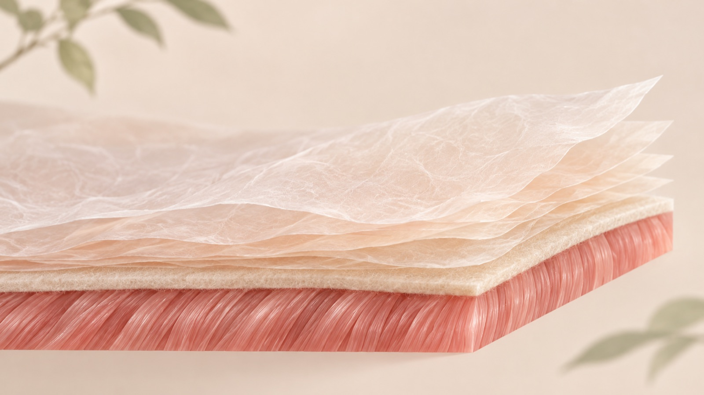
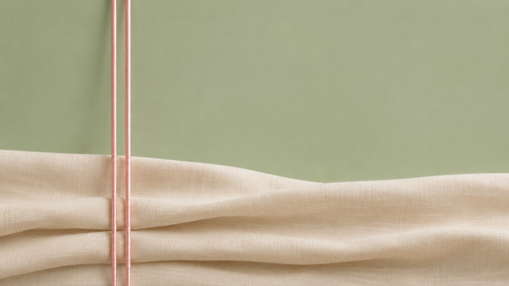

"얼굴은 아직 괜찮은데 목이 먼저 늙어 보여요." 목주름 상담에서 가장 자주 듣는 말이에요. 실제로 얼굴은 매일 신경 써서 바르고 가리지만, 목은 자외선 차단제도 보습제도 건너뛰기 쉬운 자리입니다. 그리고 상담에서 의외로 많이 놓치는 사실이 하나 있어요. 목에 생기는 '주름'은 한 종류가 아니라는 점입니다. 가로로 접히는 주름과 세로로 솟는 띠는 출발점이 달라서, 맞는 해법도 다릅니다.

## 목 피부는 왜 먼저 지칠까

*얇은 피부 바로 아래에 넓고 얇은 광경근이 펼쳐져 있다 · AI 생성 이미지*

피부는 겉의 표피, 탄력을 맡은 진피, 그 아래 피하지방으로 이뤄져요. 목은 이 가운데 진피가 얼굴보다 얇고, 피지선과 털구멍(모낭) 같은 '피부 부속기관'도 적습니다. 부속기관은 상처가 났을 때 새 피부가 자라 나오는 출발점이기도 해서, 이것이 적다는 건 손상에서 회복하는 힘이 상대적으로 약하다는 뜻이에요. 레이저 학계에서 목을 "얼굴보다 흉터가 잘 생기는 부위"로 따로 다루는 이유입니다.

여기에 목은 하루에도 수천 번 숙이고 돌리며 접히는 관절 바로 위의 피부예요. 같은 자리에서 반복해 접히다 보면, 진피의 콜라겐과 탄력섬유가 자외선으로 약해질수록 그 접힌 자리가 펴지지 않고 선으로 남습니다. 이것이 목의 **가로 주름**이에요.

반면 **세로 띠**는 피부보다 한 층 아래에서 시작돼요. 피부 바로 밑에는 광경근이라는, 종잇장처럼 얇고 넓은 근육이 턱 아래에서 쇄골까지 펼쳐져 있습니다. 표정을 지을 때 입꼬리를 아래로 당기는 데 쓰이는 근육인데, 나이가 들면서 이 근육의 앞쪽 가장자리가 도드라지고 힘을 줄 때 세로로 팽팽한 줄처럼 솟아요. 턱선이 흐려 보이는 데에도 이 근육의 당김이 한몫합니다.

> 가로 주름은 '피부'의 문제에 가깝고, 세로 띠는 '근육'의 문제에 가깝습니다.

## 스마트폰 때문일까, 피부 때문일까

SNS에서는 스마트폰을 내려다보는 자세, 이른바 '테크넥'이 목주름을 만든다는 이야기가 많아요. 고개를 숙이면 목 앞쪽이 접히니 그럴듯하게 들립니다. 다만 스마트폰 사용 시간과 목 가로주름을 직접 비교한 대조 연구는 지금까지 확인된 것이 없어요. 지금까지 나온 연구는 대부분 목 통증이나 척추 자세에 관한 것입니다.

임상에서 보면 젊은 나이에 선명한 가로선이 있는 경우, 타고난 피부 결이나 목의 지방 분포, 체중 변화가 함께 작용하는 일이 흔해요. 자세는 거들 수 있는 요인 정도로 보는 게 지금 근거에 맞는 판단입니다. 오히려 근거가 탄탄한 쪽은 자외선이에요. 햇빛에 노출되는 목 옆면과 앞쪽에 붉은 기와 갈색 얼룩, 얇아진 피부가 함께 나타나는 광노화는 피부과에서 아주 흔히 보는 모습입니다.

## 가로 주름에는 무엇을, 어느 층에

가로 주름에 가장 많이 쓰는 방법은 히알루론산 주사예요. 히알루론산은 진피에 원래 있는 성분으로, 물을 붙잡아 접힌 자리를 안쪽에서 받쳐 줍니다. 목에는 얼굴 볼륨용보다 묽은 제품을 진피에 아주 얕게, 주름 선을 따라 소량씩 넣는 방식이 쓰여요.

근거도 꽤 쌓였어요. 2026년에 발표된 다기관 무작위 임상시험 두 건에서 중등도 이상의 목 가로주름에 히알루론산을 주사한 사람의 약 72~88%가 주름 척도에서 한 단계 이상 나아졌고, 기존 제품과 견줘 뒤지지 않았으며 심각한 이상반응은 보고되지 않았어요. 미국에서 진행된 소규모 무작위 연구에서는 개선이 1년까지 유지됐습니다. 다만 대부분 업체가 참여한 연구이고, 한 단계 개선이 '주름이 사라진다'는 뜻은 아니라는 점은 알아 두세요.

주의할 점도 분명해요. 목 피부는 얇아서 너무 얕게 들어가면 푸르스름하게 비치거나(틴들 현상), 작은 혹처럼 만져질 수 있어요. 멍과 붓기는 흔한 편이고, 며칠 갑니다. 목에도 혈관이 지나기 때문에 드물지만 혈관이 막히는 합병증 가능성이 있어서, 주사 뒤 피부색이 하얗게 질리거나 점점 심해지는 통증이 있으면 바로 알려야 해요.

레이저와 고주파 같은 에너지 장비는 진피에 열을 줘 콜라겐 재생을 유도하는 방식이에요. 피부결이 얇고 처진 목에 도움이 될 수 있지만, 목에서는 출력을 낮추는 게 원칙입니다. 박피성 프랙셔널 CO2 레이저를 목에 시술한 뒤 두꺼운 흉터(비후성 흉터)가 생긴 사례들이 보고돼 있어서, 목에서는 출력과 밀도를 낮추고 시술 범위를 좁게 잡아요.

## 세로 띠에는 근육을 쉬게 하는 방법

*가로로 접히는 주름과 세로로 당겨지는 띠는 출발점이 다르다 · AI 생성 이미지*

세로 띠는 피부를 채워서는 풀리지 않아요. 원인이 근육의 당김이니 근육의 힘을 덜어 주는 보툴리눔 톡신이 쓰입니다. 이 방법은 근거 면에서 한 걸음 나아갔어요. 미국 FDA는 2024년 10월, 보툴리눔 톡신 제제를 성인의 중등도~중증 광경근 띠 개선에 쓰도록 승인했어요. 이 제품의 미용 적응증 가운데 얼굴 밖에서 받은 첫 승인입니다.

승인의 바탕이 된 두 건의 3상 위약대조 임상시험에서, 주사를 맞은 쪽은 14일째 위약군보다 뚜렷하게 많이 개선됐어요. 효과는 넉 달(120일)에 걸쳐 서서히 줄었습니다. 즉 근육이 다시 힘을 찾으면 띠도 돌아오기 때문에, 유지하려면 반복이 필요해요. 국내 허가 적응증은 제품마다 다르니 상담할 때 확인하는 게 좋습니다.

목에서 톡신을 쓸 때 가장 조심하는 것은 삼킴과 목소리예요. 광경근 바로 아래에는 삼키고 고개를 받치는 근육들이 있어서, 약이 깊게 들어가거나 많이 퍼지면 삼킴곤란이나 목의 힘 빠짐이 생길 수 있어요. 제품 설명서에도 독소가 퍼지는 효과로 삼킴곤란과 호흡곤란이 올 수 있다는 경고가 들어 있습니다. 임상시험에서는 이런 사례가 드물었지만, 이는 정해진 용량을 얕게 근육에만 넣었을 때의 이야기예요. 원래 삼킴이 불편하거나 신경근육 질환이 있는 사람은 반드시 미리 알려야 합니다.

## 내 목은 어느 쪽일까: 판단 기준

목 처짐이 심하고 늘어진 피부가 많다면, 주사나 장비만으로는 한계가 있어요. 이 경우에는 수술적인 방법까지 함께 견줘 보는 것이 현실적입니다. 반대로 피부가 비교적 탄탄하고 선이나 띠가 주된 고민이라면 시술의 몫이 커요.

- **거울 앞에서 "이" 소리를 내며 입꼬리를 아래로 당겨 보세요.** 세로 줄이 솟으면 근육 쪽, 고개를 들어도 가로선이 남으면 피부 쪽 고민일 가능성이 커요.
- **가로 주름은 피부를 채우고 재생시키는 방법**, 세로 띠는 근육의 힘을 덜어 주는 방법이 기본 방향입니다.
- **목에는 얼굴보다 보수적인 설정이 원칙이에요.** 얇고 회복이 느린 피부라는 점을 기억하세요.
- **삼킴이 불편하거나 지병이 있다면 미리 말하세요.** 톡신을 쓸지 정하는 데 꼭 필요한 정보입니다.
- **가장 근거가 탄탄한 관리는 매일 목까지 바르는 자외선 차단제와 보습**이에요. 시술 효과를 오래 가게 하는 바탕이기도 합니다.

목주름은 하나의 고민처럼 보여도 사실은 피부와 근육, 두 층의 이야기예요. 어느 층의 문제인지 먼저 나누면, 기대할 수 있는 것과 기대하면 안 되는 것도 훨씬 분명해집니다.
