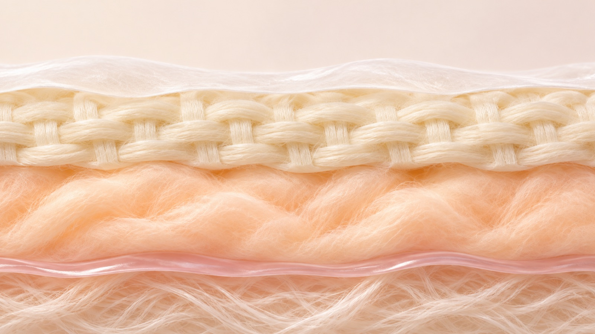
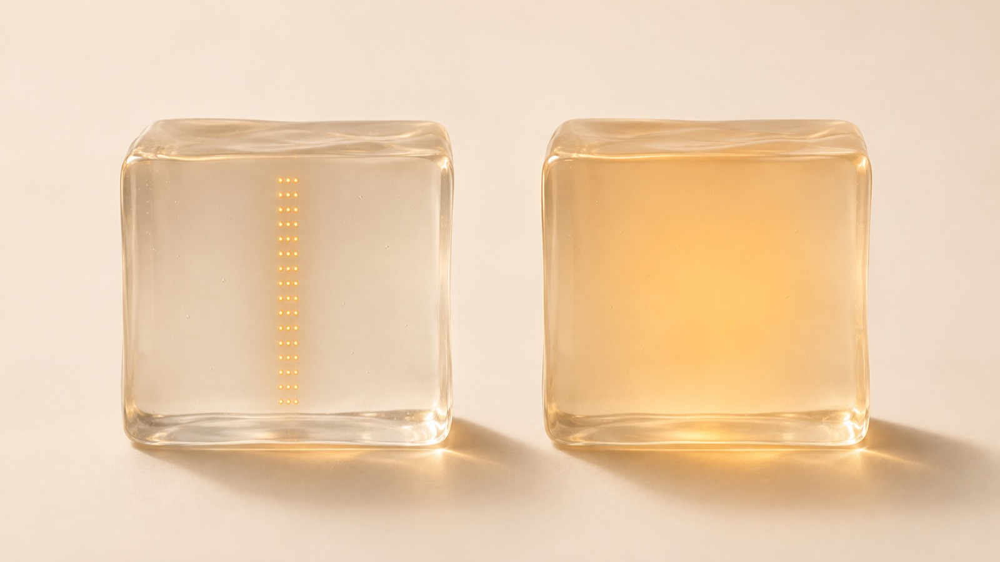
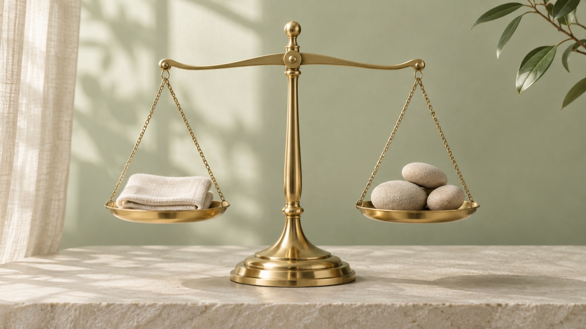

"초음파 리프팅이랑 고주파 리프팅, 뭐가 더 세요?" 리프팅 상담에서 가장 자주 받는 질문이에요. 그다음으로 많은 건 "그거 받으면 얼굴 살이 빠진다던데요?"입니다. 두 질문 모두 출발점이 같아요. 장비 리프팅을 '세기'의 문제로 생각한다는 점이죠. 그런데 피부과에서는 세기보다 먼저 **열이 어느 층에 닿는가**를 봅니다.

관심 자체는 분명히 커졌어요. 국내 한 미용의료 플랫폼의 2026년 1분기 이용자 데이터에서는 리프팅이 필러와 보톡스를 제치고 가장 많이 찾아본 분야가 됐다는 보도가 나왔어요. 찾아보는 사람이 많아질수록, 원리를 알고 고르는 게 더 중요해집니다.

## 처짐은 한 층에서만 일어나지 않아요

*피부 아래에는 진피, 지방, 근막이 층층이 놓여 있다 · AI 생성 이미지*

얼굴 피부를 위에서부터 내려가 보면 얇은 표피, 탄력을 맡은 진피, 쿠션 역할의 피하지방, 그리고 그 아래 근육을 감싼 얇은 막이 있어요. 이 막을 근막, 의학 용어로 SMAS(표재성 근건막층)라고 부릅니다. 수술로 하는 안면거상술이 당겨 올리는 층이 바로 이 SMAS예요.

나이가 들면 이 모든 층이 조금씩 변해요. 진피의 콜라겐과 탄력섬유는 자외선과 시간에 의해 줄고 느슨해지고, 지방은 덩어리째 아래로 내려가거나 자리마다 다르게 꺼지며, 얼굴을 뼈에 붙잡아 두던 인대도 느슨해집니다. 그래서 같은 '처짐'이라도 어떤 사람은 피부 결이 얇아지고 잔주름이 늘어난 상태이고, 어떤 사람은 피부보다 지방과 인대가 내려온 상태예요. 장비가 어느 층을 겨냥하느냐가 중요한 이유가 여기 있습니다.

## 초음파는 점으로, 고주파는 면으로 데워요

*초음파는 깊은 곳에 점을 찍고, 고주파는 진피를 넓게 데운다 · AI 생성 이미지*

**미세집속초음파**는 돋보기로 햇빛을 한 점에 모으듯 초음파를 피부 속 특정 깊이에 모아요. 탐촉자(피부에 대는 머리 부분)마다 초점 깊이가 정해져 있는데, 대략 1.5mm는 진피, 3.0mm는 깊은 진피, 4.5mm는 SMAS 층을 겨냥합니다. 초점이 맺힌 자리에는 1mm³ 안팎의 아주 작은 응고점이 생기고, 그 안의 콜라겐이 60~70°C 정도로 데워져요. 표면은 비교적 그대로 두고 깊은 곳에 점점이 열 자국을 남기는 방식이죠.

**단극성 고주파**는 원리가 달라요. 전류가 조직을 지나갈 때 생기는 저항으로 열을 만들어서, 진피를 넓게, 부피 단위로 데웁니다. 표면은 냉각 장치로 식혀 표피를 보호해요. 콜라겐은 약 65°C 안팎에서 일부 구조가 풀리며 그 자리에서 수축하고, 이후 몇 달에 걸친 상처 회복 과정에서 섬유아세포가 새 콜라겐을 만듭니다.

> 초음파는 깊은 곳에 점을 찍고, 고주파는 진피를 넓게 데운다. '더 센 것'이 아니라 '다른 층'을 다루는 도구예요.

두 방식 모두 결과가 하루아침에 나타나지 않는 것도 이 때문이에요. 열로 수축한 콜라겐이 다시 짜이고 새 콜라겐이 쌓이는 데는 보통 수개월이 걸리고, 그 정도는 사람마다 꽤 다릅니다.

## 허가와 연구가 말해 주는 범위는 생각보다 좁아요

미국 FDA는 미세집속초음파 장비를 눈썹 올림, 턱밑과 목의 늘어진 조직 리프팅, 앞가슴 잔주름 개선 용도로 허가했어요. 단극성 고주파 장비는 2002년에 눈가 주름의 비침습 치료 용도로 처음 허가받았고요. 허가 적응증은 "이 범위에서는 효과와 안전성을 확인했다"는 뜻이지, 얼굴 전체를 수술처럼 끌어올린다는 뜻은 아니에요.

임상 연구들도 비슷한 이야기를 합니다. 집속초음파 연구를 모은 체계적 문헌고찰에서는 피부 늘어짐이 개선됐다는 보고가 꾸준하지만, 대부분 경도에서 중등도의 처짐을 대상으로 한 연구였어요. 늘어짐이 깊고 지방과 인대가 많이 내려온 경우, 비수술 에너지 장비로 안면거상술만큼의 변화를 기대하기는 어렵다는 게 피부과와 성형외과의 일반적인 시각입니다.

## 누구에게 잘 맞고, 무엇을 조심해야 할까

*잘 맞는 경우와 기대치를 낮춰야 하는 경우를 함께 따져 본다 · AI 생성 이미지*

임상에서 흔히 잘 맞는다고 보는 경우는 이래요. 30대 후반에서 50대 초반, 피부 두께가 어느 정도 있고, 처짐이 경도에서 중등도이며, 턱선이 살짝 흐려지거나 눈썹 위치가 조금 내려온 정도의 변화예요. 피부가 얇고 잔주름 위주라면 진피를 넓게 데우는 고주파 쪽이, 턱선이나 턱밑처럼 조금 더 깊은 지지 구조가 문제라면 초음파 쪽이 논리적으로 더 가깝습니다. 실제로는 두 가지를 층별로 나눠 함께 계획하기도 해요.

반대로 기대치를 낮춰야 하는 경우도 있어요. 처짐이 심하거나, 이미 볼과 관자놀이가 많이 꺼진 얇고 마른 얼굴이 그렇습니다. 꺼진 얼굴에 깊은 층까지 열을 반복해서 주면, 드물지만 원치 않는 지방 감소로 더 꺼져 보일 수 있어요. 이럴 땐 열로 조이는 것보다 꺼진 부피를 다루는 방법이 먼저일 수 있습니다.

부작용은 대개 가벼워요. 시술 직후 붉어짐, 부기, 만지면 뻐근한 느낌이 흔하고 보통 며칠 안에 가라앉습니다. 다만 드물게 지방 감소, 입꼬리 움직임이 어색해지는 안면 신경 손상(대부분 수 주 안에 회복), 화상, 색소 변화가 보고돼요. 보고된 사례들을 보면 에너지 설정, 시술자의 해부학 이해, 대상자 선택과 관련된 경우가 많습니다. 특히 턱 아래쪽과 관자놀이에는 얕게 지나가는 신경이 있어 깊이 조절이 중요해요. 짧은 간격으로 고에너지 시술을 자주 반복하는 것도 꺼짐과 부작용 위험을 키울 수 있어 권하지 않습니다.

하나 더 분명히 해 둘 것이 있어요. 이 장비들은 의료기기예요. 식약처도 의료기관에서 의료인에게, 허가받은 부위에만 시술받으라고 안내합니다. 의료기관이 아닌 곳에서 받는 집속초음파 시술은 불법일 뿐 아니라, 깊이와 신경 위치를 판단할 사람이 없다는 점에서 위험해요.

## 상담 전에 챙길 판단 기준

장비 이름이나 샷 수보다 먼저 확인할 것들을 정리하면 이렇습니다.

- **내 처짐은 어느 층의 문제인가**: 피부가 얇아진 것인지, 지방과 인대가 내려온 것인지부터 진찰로 구분해 달라고 하세요.
- **이미 꺼진 부위가 있는가**: 볼·관자놀이가 꺼졌다면 깊은 열을 반복하는 것이 맞는지 따로 물어보세요.
- **어느 깊이를 어디에 쓰는가**: 부위별로 어느 층을 겨냥하는지, 신경이 지나는 자리는 어떻게 피하는지 설명을 들어 보세요.
- **기대 범위와 시간표**: 변화는 수개월에 걸쳐 나타나고 개인차가 크며, 수술을 대신하는 것은 아니라는 점을 서로 확인하세요.
- **시술 후 관리**: 며칠간의 붉어짐·부기는 흔하지만, 감각 저하나 입 움직임 이상, 물집은 바로 알려야 할 신호예요. 그리고 진피 콜라겐을 지키는 가장 근거 탄탄한 관리는 여전히 매일의 자외선 차단입니다.
