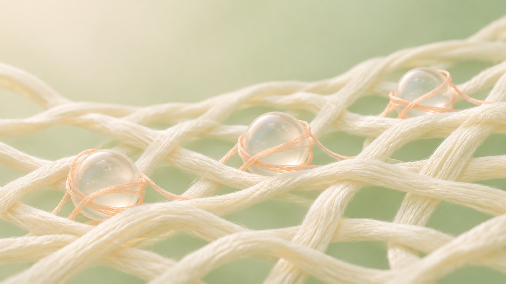
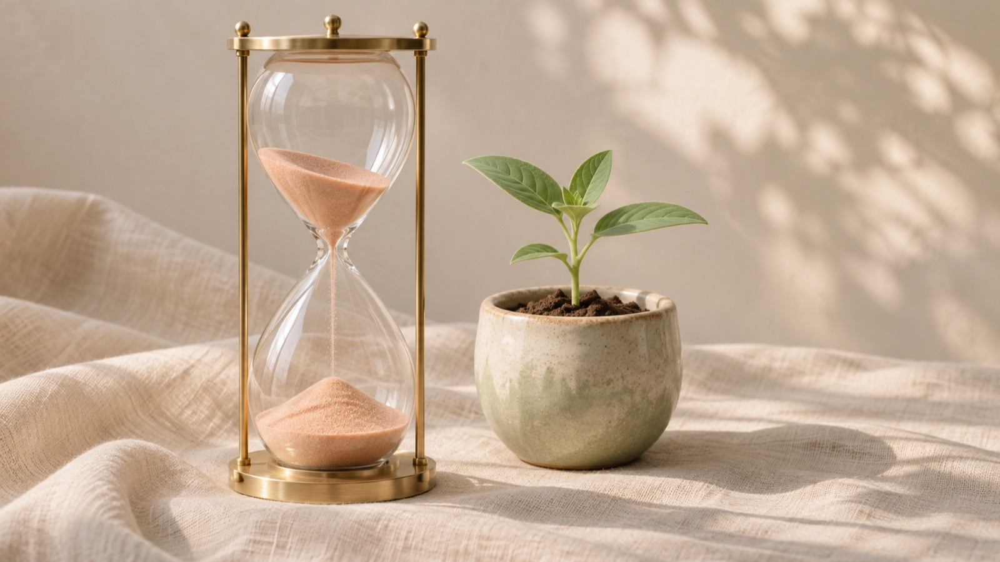

"필러는 채우는 거고, 콜라겐 주사는 내 살을 키워 주는 거라면서요?" 요즘 상담에서 자주 듣는 질문이에요. 콜라겐 생성을 유도한다는 이른바 '바이오스티뮬레이터' 주사를 다룬 논문도 최근 몇 년 사이 눈에 띄게 늘었어요. 이름만 들으면 몸이 알아서 젊어지는 주사 같지만, 실제로 피부 안에서 일어나는 일은 조금 더 역설적이에요. 이 주사는 피부에 **일부러 작은 이물 반응을 일으키는 방식**으로 작동하거든요.

## 채우는 주사와 키우는 주사는 어디서 갈릴까

*입자 주변으로 콜라겐이 조금씩 쌓인다 · AI 생성 이미지*

먼저 얼굴이 꺼지는 이유부터 볼게요. 피부는 겉의 표피, 그 아래 콜라겐 섬유가 촘촘히 짜인 진피, 그리고 더 아래의 피하지방으로 이뤄져 있어요. 나이가 들면 진피의 콜라겐이 줄어 얇아지고, 지방 칸도 줄거나 아래로 내려가면서 볼과 관자놀이가 꺼지고 팔자 주름이 깊어져요.

히알루론산 필러는 물을 끌어당기는 젤이에요. 꺼진 자리에 젤을 넣어 그 부피만큼 바로 채우죠. 반면 PLLA(폴리-L-젖산)는 녹는 수술실이나 흡수성 나사에도 쓰이는, 몸에서 천천히 분해되는 합성 고분자예요. 이 미세 입자를 물에 풀어 주사하면 주사 직후의 부피는 대부분 물이라 며칠 안에 빠지고, 진짜 변화는 몇 주에서 몇 달에 걸쳐 나타나요. 같은 원리로 쓰이는 성분으로 PDLLA(PLLA의 사촌 격 고분자), CaHA(칼슘하이드록시아파타이트), PCL(폴리카프로락톤)이 있어요.

## 일부러 작은 염증을 일으킨다고요?

PLLA 입자가 진피 깊은 곳이나 피하층에 들어가면, 몸은 이것을 '정리해야 할 이물질'로 알아봐요. 대식세포(이물질을 처리하는 면역세포)가 모여들고, 그 주변으로 섬유아세포(콜라겐을 만드는 세포)가 불려 와 입자를 감싸듯 콜라겐을 쌓기 시작해요. 학술지 리뷰는 이를 겉으로 드러나지 않을 정도의 약한 염증 반응이라고 설명해요. 입자는 1~2년에 걸쳐 분해되지만, 그 사이 쌓인 콜라겐은 남아서 부피와 피부 두께를 받쳐 줘요.

> 이 주사의 핵심은 성분이 아니라, 성분에 대한 우리 몸의 반응이에요.

그래서 결과가 사람마다 달라요. 콜라겐을 만드는 힘은 나이, 흡연, 영양 상태, 피부 두께에 따라 차이가 나고, 같은 양을 맞아도 반응의 크기가 같지 않아요. '내 살을 키운다'는 표현이 완전히 틀린 말은 아니지만, 키우는 주체는 약이 아니라 내 몸이라는 점이 중요해요.

## 왜 몇 달이 지나야 보이고, 왜 오래갈까

*결과는 몇 주가 아니라 몇 달에 걸쳐 나타난다 · AI 생성 이미지*

PLLA는 미국 식품의약국(FDA)에서 2004년 HIV 치료와 관련한 얼굴 지방 위축 교정에, 2009년에는 면역 기능이 정상인 사람의 팔자 주름과 얼굴 주름 교정에 허가를 받았어요. 근거가 쌓인 지 20년이 넘은 셈이에요.

시간에 따른 차이를 보여 주는 연구도 있어요. 중등도 이상의 팔자 주름이 있는 성인을 대상으로 한 다기관 무작위 임상시험에서 PLLA와 히알루론산 필러는 4주와 12주에는 비슷했지만, 24주 이후로는 PLLA 쪽 곡선이 앞섰어요. 마지막 주사 후 120주가 지났을 때 주름이 충분히 교정된 상태로 유지된 비율은 PLLA 약 56%, 히알루론산 25% 정도였어요. 다만 이 연구에서도 PLLA를 맞은 사람의 절반 가까이는 그 시점에 효과가 기준 아래로 내려갔어요.

무작위 임상시험 11편을 모은 체계적 문헌고찰도 효과가 최소 25개월 이어졌다고 정리했지만, 절반 가까운 연구가 비뚤림 위험이 높아 근거의 질은 낮다고 덧붙였어요. 정리하면 '천천히 오고 비교적 오래간다'는 방향은 꽤 일관되지만, 몇 년이 갈지는 아직 연구마다 편차가 커요.

## 결절은 왜 생기고, 누가 더 조심해야 할까

흔한 부작용은 멍, 부기, 주사 부위 통증처럼 가볍고 대개 며칠에서 몇 주 안에 가라앉아요. 이 주사에서 특히 알아 둘 부작용은 몇 주에서 몇 달 뒤에 만져지는 작은 구진이나 결절이에요. 이물 반응을 이용하는 시술이라, 입자가 한곳에 뭉치면 반응도 그곳에 몰리기 때문이에요.

결절은 운에만 달린 일이 아니에요. 2008년 리뷰는 희석이 부족하거나 현탁액이 고르지 않을 때, 너무 얕게 주사할 때, 시술 뒤 마사지가 부족할 때 결절이 잘 생긴다고 정리했고, 40편의 연구를 모은 2026년 범위 고찰도 희석 방법, 주입 기법, 주입 깊이와의 관련성을 다시 확인했어요. 드물게는 염증성 육아종이나 세균막 감염 형태로 나타나 스테로이드 주사나 항생제 치료가 필요할 수도 있어요. 피부가 얇은 눈가나 입술처럼 근육이 많이 움직이는 부위에 조심스럽게 쓰는 이유이기도 해요.

몸 상태도 봐야 해요. 2026년에는 자가염증 질환인 성인형 스틸병 환자가 얼굴에 PLLA를 맞은 지 5일 뒤 전신 증상이 크게 악화된 증례가 보고됐어요. 단 한 건이라 인과관계를 말할 수는 없지만, 자가면역·자가염증 질환이 있거나 면역 치료를 받고 있다면 시술 전에 반드시 담당 의료진과 이야기해야 해요. 시술 부위에 염증이나 감염이 있을 때, 켈로이드처럼 흉터가 두껍게 올라오는 체질일 때도 신중해야 하고요. 같은 계열의 CaHA는 혈관 압박으로 조직이 상하는 중증 사례가 보고된 적이 있어, 어떤 주사든 해부학을 잘 아는 의료진에게 받는 것이 기본이에요.

PDLLA를 진피에 얕게 넣는 방식은 피하에 넣는 방식보다 통증이 확실히 컸다는 작은 무작위 연구도 있어요. 같은 계열이라도 어느 층에 얼마나 넣느냐에 따라 경험이 꽤 달라진다는 뜻이에요.

## 결정하기 전에 따져 볼 다섯 가지

잘 맞는 쪽은 처짐보다 '꺼짐'과 '얇아짐'이 고민인 경우예요. 볼과 관자놀이가 전반적으로 꺼졌거나 피부가 얇아져 잔주름이 늘었다면, 콜라겐 바탕을 다지는 이 방식이 의미가 있을 수 있어요. 반대로 피부가 많이 늘어져 아래로 처진 경우라면, 부피를 더하는 것만으로는 한계가 있어 다른 방법이 우선일 수 있어요.

- **기다릴 수 있나요?** 결과는 몇 달에 걸쳐 나타나고, 보통 몇 주 간격으로 여러 번 맞아요. 당장 다음 주 행사를 위한 시술은 아니에요.
- **고민이 꺼짐인가요, 처짐인가요?** 부피 부족에는 맞지만, 심한 처짐에는 기대치를 낮춰야 해요.
- **되돌릴 수 있나요?** 히알루론산 필러는 분해 효소로 녹일 수 있지만, PLLA는 녹이는 약이 따로 없어요.
- **내 몸 상태는 괜찮나요?** 자가면역 질환, 켈로이드 체질, 시술 부위 염증이 있다면 먼저 알리세요.
- **어떻게 넣는지 물어보세요.** 희석 방법, 주사 깊이, 시술 뒤 마사지 방법은 결절 위험과 직결되는 질문이에요.

시술 뒤에는 안내받은 대로 며칠간 부위를 마사지하고, 몇 주 뒤에 단단하게 만져지는 것이 생기면 그냥 두지 말고 시술한 곳에서 확인을 받는 것이 좋아요. 그리고 어떤 주사를 고르든, 자외선 차단은 콜라겐이 다시 줄어드는 속도를 늦추는 가장 근거가 탄탄한 생활 관리라는 점은 변하지 않아요.
